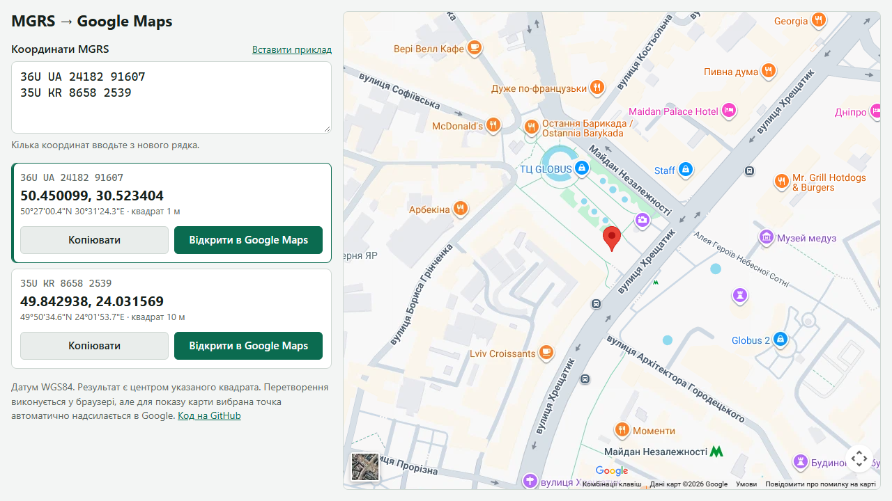

# MGRS → Google Maps

[](https://github.com/MeffMara/mgrs-converter/actions/workflows/ci.yml)
[](LICENSE)

Вебзастосунок, який перетворює координати MGRS на широту й довготу WGS84 та показує точку на Google Maps. Працює прямо в браузері, без встановлення та реєстрації.

**[Відкрити застосунок →](https://meffmara.github.io/mgrs-converter/)**



## Можливості

- Конвертація під час введення, з пробілами чи без, малими або великими літерами.
- Кілька координат одночасно, кожна з нового рядка.
- Результат у десятковому форматі та у градусах, хвилинах і секундах.
- Вбудована карта, копіювання координат і відкриття точки в Google Maps.
- Зрозумілі повідомлення про помилки у введених даних.
- Адаптивний інтерфейс для телефона, світла й темна теми.
- Жодних залежностей, збирання чи сервера.

## Приклади

| MGRS | Широта, довгота | Розмір квадрата |
| --- | --- | --- |
| `36U UA 24182 91607` | `50.450099, 30.523404` | 1 м |
| `35U KR 8658 2539` | `49.842938, 24.031569` | 10 м |
| `56H LH 34368 50948` | `-33.868799, 151.209299` | 1 м |

Застосунок повертає **центр** указаного квадрата. Точність залежить від кількості цифр:

| Цифр | Розмір квадрата |
| --- | --- |
| 10 | 1 м |
| 8 | 10 м |
| 6 | 100 м |
| 4 | 1 км |
| 2 | 10 км |
| 0 | 100 км |

## Конфіденційність

Конвертація виконується локально в браузері. Застосунок не має сервера, бази даних чи аналітики й не зберігає введені координати.

> [!WARNING]
> Щоб показати карту, застосунок **автоматично надсилає вибрану точку в Google**. Кнопка «Відкрити в Google Maps» також передає координати Google, а посилання залишається в історії браузера. Не вводьте координати, розголошення яких може комусь зашкодити.

## Обмеження

- Полярні області (смуги A, B, Y, Z) не підтримуються.
- Для карти потрібен інтернет.

## Локальний запуск

```bash
git clone https://github.com/MeffMara/mgrs-converter.git
cd mgrs-converter
```

Відкрийте `index.html` у браузері. Вебсервер не потрібен.

## Тести

Потрібен [Node.js](https://nodejs.org/) 20 або новіший.

```bash
npm test
```

## Структура проєкту

```text
├── index.html          # інтерфейс застосунку
├── mgrs.js             # конвертація MGRS у WGS84
├── test/               # автоматичні тести
├── docs/               # зображення для документації
└── .github/workflows/  # перевірка тестів на GitHub
```

## Ліцензія

Проєкт розповсюджується за ліцензією [MIT](LICENSE).
